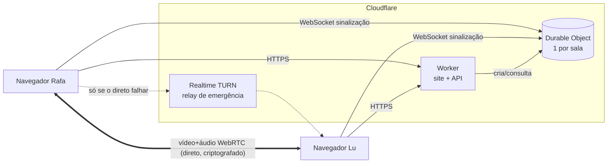
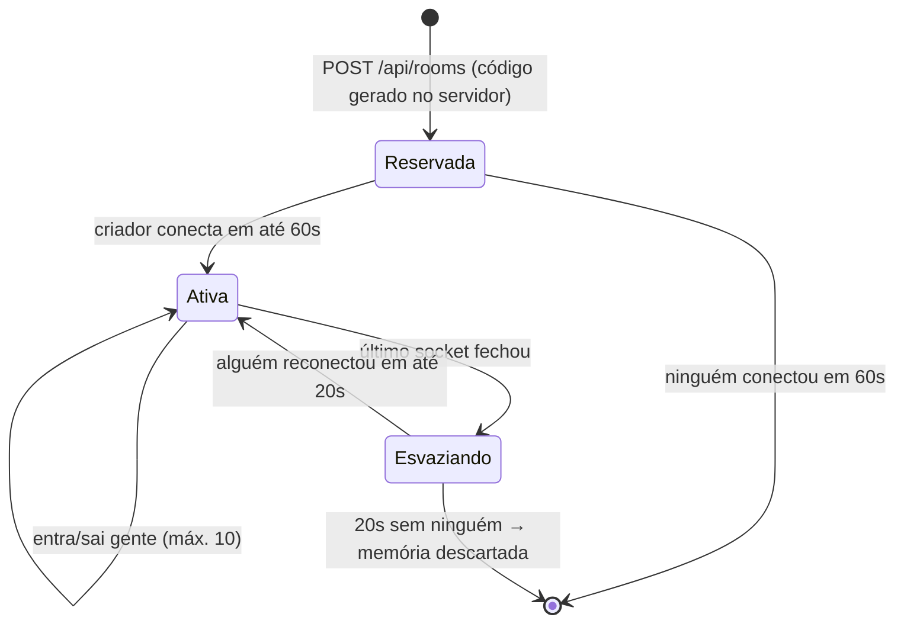
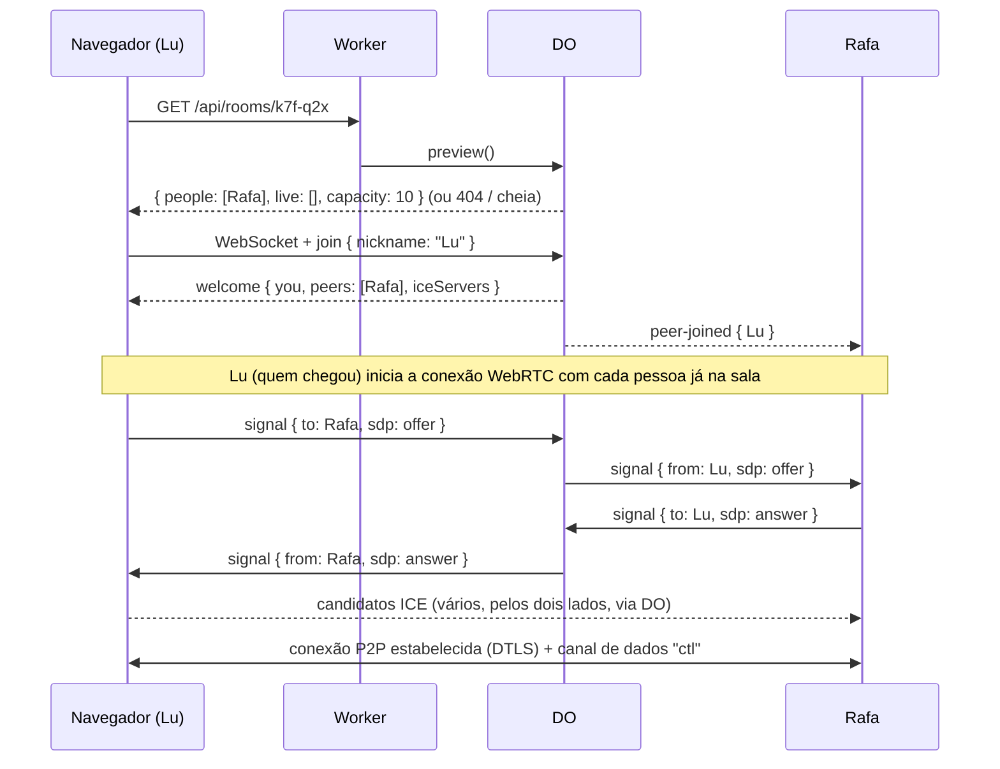
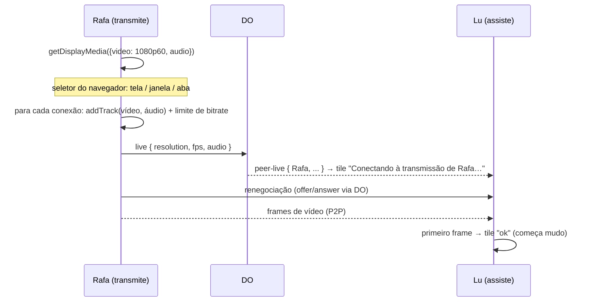

# Arquitetura — como o Espia funciona de ponta a ponta

Este documento explica **como** o produto funciona por dentro: quem fala com quem, como o vídeo
sai da sua tela e chega na tela dos amigos, e que tecnologia faz cada parte. Segurança está em
[security.md](./security.md); as mensagens exatas estão em [contracts/](./contracts/).

## 1. Visão geral em uma frase

O servidor só **apresenta** os navegadores uns aos outros; depois disso o **vídeo vai direto de
navegador para navegador**, criptografado, e o servidor nunca vê nem carrega a imagem.



| Peça | O que faz | O que **não** faz |
|---|---|---|
| **Navegador** | Captura a tela, codifica, envia e recebe vídeo, desenha a interface | — |
| **Worker** | Entrega o site, cria salas, responde "essa sala existe?", abre o WebSocket da sala | Não toca no vídeo |
| **Durable Object (DO)** | Um "mini-servidor" por sala: lista de quem está, repassa mensagens de combinação (SDP/ICE), avisa quem entrou/saiu/está ao vivo, entrega credenciais TURN | Não toca no vídeo; não grava nada em disco |
| **TURN** | Retransmite pacotes **já criptografados** quando duas pessoas não conseguem se conectar direto (4G, CGNAT, rede de empresa) | Não consegue ver o conteúdo |

## 2. Ciclo de vida de uma sala



- O **código** (`k7f-q2x`) é gerado **no servidor** (`crypto.getRandomValues`), não no navegador: evita colisão e impede escolher códigos.
- Cada código vira um Durable Object (`idFromName(código)`). Quem está conectado fica no *attachment* de cada WebSocket (sobrevive à hibernação). A reserva de 60 s, quem está na tolerância de 20 s e o contador de tons ficam no storage do DO, cujas chaves são **todas apagadas** quando a sala esvazia: o código volta a "não existir" e nada sobre as pessoas fica guardado.
- Os 20 s de "esvaziando" existem para que uma queda rápida de internet (ou um F5) não derrube a sala nem gere "saiu/entrou".

## 3. Fluxos

### 3.1 Criar sala

```mermaid
sequenceDiagram
  participant R as Navegador (Rafa)
  participant W as Worker
  participant D as DO k7f-q2x
  R->>W: POST /api/rooms
  W->>W: limite por IP; gera código
  W->>D: reserve()
  D-->>W: ok (ou "ocupado" → gera outro)
  W-->>R: { code: "k7f-q2x" }
  R->>R: navega para /s/k7f-q2x (apelido já digitado)
  R->>W: GET /ws/k7f-q2x (upgrade)
  W->>D: repassa o WebSocket
  R->>D: join { nickname: "Rafa" }
  D-->>R: welcome { you, peers: [], iceServers, resumeToken }
```

### 3.2 Entrar por link



A conexão entre cada par é criada **logo ao entrar**, mesmo sem ninguém ao vivo. Assim, quando
alguém clica Go Live, a conexão já existe e o vídeo aparece em ~1 s (só precisa "renegociar").
Para a conexão nascer sem vídeo, abrimos um **canal de dados** `ctl` (usado depois para controle de qualidade).

### 3.3 Go Live



- **Negou/fechou o seletor** → `NotAllowedError` → alerta E3, nada é enviado.
- **Parar transmissão** (botão ou o "Parar de compartilhar" do navegador → `track.onended`) → `removeTrack` em cada conexão + `unlive`.

### 3.4 Sair / cair

- Fechou a aba → o WebSocket fecha → após 20 s de tolerância o DO envia `peer-left` → os outros fecham a conexão com essa pessoa e o tile some.
- Internet piscou → o navegador reconecta o WebSocket (1 s, 2 s, 4 s… até 10 s) com `resume { resumeToken }` e recupera a mesma identidade; as conexões P2P costumam **continuar funcionando** durante a queda do WebSocket, porque o vídeo não passa por ele.

## 4. Como o compartilhamento funciona (WebRTC em detalhe)

### 4.1 Topologia: malha (mesh)
Cada par de pessoas tem **uma** `RTCPeerConnection`. Uso normal (3–5 pessoas): até 10 conexões na
sala, 4 por navegador. No limite (10 pessoas): 45 conexões na sala, 9 por navegador.
Quem transmite **codifica e envia uma cópia para cada espectador** — é o custo de não ter servidor de mídia.

| Configuração | Bitrate máx. por espectador | Upload com 4 espectadores |
|---|---|---|
| 720p · 30 fps | 2,5 Mbps | ~10 Mbps |
| 720p · 60 fps | 4 Mbps | ~16 Mbps |
| 1080p · 30 fps | 4,5 Mbps | ~18 Mbps |
| 1080p · 60 fps | 6 Mbps | ~24 Mbps |

O WebRTC **se adapta sozinho**: se a rede de alguém piorar, o envio para *aquela pessoa* cai de
qualidade sem afetar os outros (cada conexão tem seu próprio controle de congestionamento).

### 4.1b Qualidade automática pelo número de espectadores
Para a sala aguentar até 10 pessoas sem servidor de vídeo, quem transmite tem um **teto** que
depende de quantas pessoas estão assistindo em tela cheia/grade (miniaturas e ocultos não contam, §4.2).
O teto **nunca sobe** acima do que a pessoa escolheu no modal Go Live.

| Espectadores | Teto | Upload máx. de quem transmite |
|---|---|---|
| 1–4 (uso normal) | o que foi escolhido (até 1080p · 60 fps) | ~24 Mbps |
| 5–6 | 720p · 60 fps se escolheu 60 fps; senão 1080p · 30 fps (≤ 4 Mbps cada) | ~24 Mbps |
| 7–9 (limite) | 720p · 30 fps (2,5 Mbps cada) | ~22,5 Mbps |

- O teto é reavaliado sempre que alguém entra, sai ou muda de miniatura para foco.
- Mudança de resolução/fps: `track.applyConstraints()` na captura (vale para todos os envios, alivia a CPU); bitrate por envio: `sender.setParameters()`.
- Quem transmite vê a qualidade **efetiva** no card "Você está ao vivo" (ex.: "8 assistindo · 720p · 30 fps · ajustado"). Quem assiste vê a mesma no subtítulo ("720p · 30 fps"); para isso, quem transmite reenvia `live` com a qualidade efetiva.
- O modal Go Live avisa antes, quando a sala tem mais de 5 pessoas: "Com N pessoas na sala, a qualidade vai ser ajustada para …".
- 9 codificações de 720p30 ao mesmo tempo pesam na CPU: o spike T046 mede também esse caso.
- Download de quem assiste: cada transmissão ao vivo custa o bitrate dela; 3 pessoas ao vivo em 720p30 ≈ 7,5 Mbps.

### 4.2 Economia de upload: miniatura vs. foco
Quando um espectador está com a sua tela **em miniatura** (faixa do modo foco), ele avisa pelo
canal `ctl` → você reduz o envio **só para ele** para ~360p · 15 fps · 0,5 Mbps
(`RTCRtpSender.setParameters` com `scaleResolutionDownBy`, `maxFramerate`, `maxBitrate`).
Quando ele volta a focar a sua tela, a qualidade volta. Na grade, todos recebem a qualidade cheia.

### 4.3 Captura
```ts
navigator.mediaDevices.getDisplayMedia({
  video: { width: { ideal: 1920 }, height: { ideal: 1080 }, frameRate: { ideal: 60 } },
  audio: wantsAudio ? { echoCancellation: false, noiseSuppression: false, autoGainControl: false } : false,
  systemAudio: 'include',      // Chrome/Edge: oferece áudio do sistema (Windows/ChromeOS)
  selfBrowserSurface: 'exclude', // não oferece a própria aba do Espia (evita espelho infinito)
  surfaceSwitching: 'include', // botão "compartilhar esta aba" para trocar de aba sem parar
});
```
- `contentHint`: `'motion'` em 60 fps (jogos/vídeo — prioriza fluidez), `'detail'` em 30 fps (código/slides — prioriza nitidez).
- `degradationPreference`: `'maintain-framerate'` (60 fps) ou `'maintain-resolution'` (30 fps).
- Áudio: Opus estéreo ~128 kbps, sem os filtros de voz (que estragam música de jogo).

| Navegador | Transmitir vídeo | Transmitir áudio | Assistir |
|---|---|---|---|
| Chrome / Edge (Windows) | ✅ | ✅ aba e sistema inteiro | ✅ |
| Chrome / Edge (macOS/Linux) | ✅ | ✅ só de aba | ✅ |
| Firefox desktop | ✅ | ❌ | ✅ |
| Safari macOS | ✅ | ❌ | ✅ |
| Celular (qualquer) | ❌ | ❌ | ✅ |

### 4.4 Codec
Com malha, 1080p60 para 4 pessoas = **4 codificações simultâneas**. Codificação por hardware alivia
muito a CPU. Plano: preferir **H.264** (hardware em quase todo PC) e cair para **VP9/VP8**
(`RTCRtpTransceiver.setCodecPreferences`). A escolha final sai de um **spike de medição**
(tarefa T046): CPU e qualidade de texto com 4 espectadores em 1080p60.

### 4.5 Combinação da conexão ("perfect negotiation")
Padrão oficial do WebRTC para os dois lados poderem renegociar sem conflito:
- Cada par tem um lado **educado** (`polite`) e um **mal-educado**: decide-se comparando os IDs.
- Se as duas ofertas se cruzarem, o educado desiste da sua e aceita a do outro.
- Candidatos ICE são enviados aos poucos (*trickle*), pelo DO.

### 4.6 Como a conexão atravessa a internet (ICE)
1. **Direto na rede local** (endereços ocultados por mDNS pelo navegador).
2. **Direto pela internet** usando STUN (`stun.cloudflare.com`) para descobrir o IP público — resolve a maioria das casas.
3. **TURN** (`turn.cloudflare.com`, UDP/TCP/TLS na porta 443) quando 1 e 2 falham — 4G com CGNAT, redes corporativas. Paga por GB (ver §6).

### 4.7 Estados do tile (o que o espectador vê)
| Evento | Tile |
|---|---|
| `peer-live` chegou, ainda sem frame | `loading` — "Conectando à transmissão de X…" |
| primeiro frame decodificado (`requestVideoFrameCallback`) | `ok` (mudo) |
| `connectionState = failed` ou 10 s sem frame | `failed` — "Não deu pra conectar com X" |
| "Tentar de novo" | `restartIce()`; se falhar de novo, recria a conexão |

## 5. Tecnologias

| Camada | Tecnologia | Versão | Por quê |
|---|---|---|---|
| Interface | **Svelte 5** (runes) + **Vite** + **TypeScript** | 5.x / 8.x / 6.x | Leve, reativo, sem runtime pesado; já em uso |
| Ícones / fontes | `@lucide/svelte`; **@fontsource** (Caprasimo, Figtree) **auto-hospedadas** | — | Sem Google Fonts em produção (privacidade, ver security.md) |
| Vídeo/áudio | **APIs nativas do navegador**: `getDisplayMedia`, `RTCPeerConnection`, `RTCDataChannel` | — | Sem bibliotecas tipo simple-peer: o padrão perfect negotiation tem ~150 linhas e controlamos tudo |
| Servidor | **Cloudflare Workers** (TypeScript) | — | Grátis, global, sem servidor para manter |
| Estado da sala | **Durable Objects** (classe SQLite, *WebSocket Hibernation API*) | — | Um objeto por sala; hibernação = custo ~0 enquanto ninguém manda mensagem. No plano grátis só existe a classe SQLite (não usaremos o armazenamento dela) |
| Site estático | **Workers Static Assets** (`not_found_handling: single-page-application`) | — | O próprio Worker entrega o `dist/` |
| Limite de abuso | **Rate Limiting binding** do Workers | — | Contadores por IP (aproximados, por região) |
| Relay | **Cloudflare Realtime TURN** | — | Credenciais temporárias geradas pelo servidor |
| Ferramentas | **wrangler 4**, Vitest, `@cloudflare/vitest-pool-workers`, Playwright | — | Deploy, testes unitários, testes do DO, testes ponta a ponta com captura falsa |

Validação de mensagens no servidor: **validadores escritos à mão** (poucos tipos de mensagem; evita dependência).

## 6. Custos (plano grátis da Cloudflare)

| Recurso | Cota grátis | Uso estimado |
|---|---|---|
| Workers | 100 mil requisições/dia | site + API: pouquíssimo |
| Durable Objects | 100 mil requisições/dia, 13 mil GB-s/dia | cada conexão WS = 1 req; mensagens recebidas contam 20:1; hibernação zera a duração ociosa |
| Realtime TURN | **1.000 GB/mês grátis**, depois US$ 0,05/GB | só conexões que falham no direto. 1 espectador em 1080p60 via TURN ≈ 2,7 GB/h → ~370 h/mês de espectador-relay grátis |

Proteção de custo: credenciais TURN só para quem está numa sala, revogadas ao sair (security.md §4),
e alerta de uso configurado no painel da Cloudflare.

## 7. Estrutura do código (fase real)

```text
src/lib/
  room-id.ts         código da sala (feito)
  prefs.ts           localStorage
  router.ts          / e /s/:código
  signaling.ts       WebSocket: conectar, reconectar, resume, fila de envio
  peer.ts            uma RTCPeerConnection (perfect negotiation, ctl, bitrate, stats)
  mesh.ts            conjunto de peers da sala; add/remove da transmissão
  capture.ts         getDisplayMedia + contentHint + onended
  stores/            room, streams, broadcast, toasts (Svelte runes) → produzem RoomView
src/worker/
  index.ts           rotas, cabeçalhos de segurança, rate limit, Origin
  room.ts            Durable Object Room
  validate.ts        validação das mensagens
  turn.ts            gerar/revogar credenciais
```
