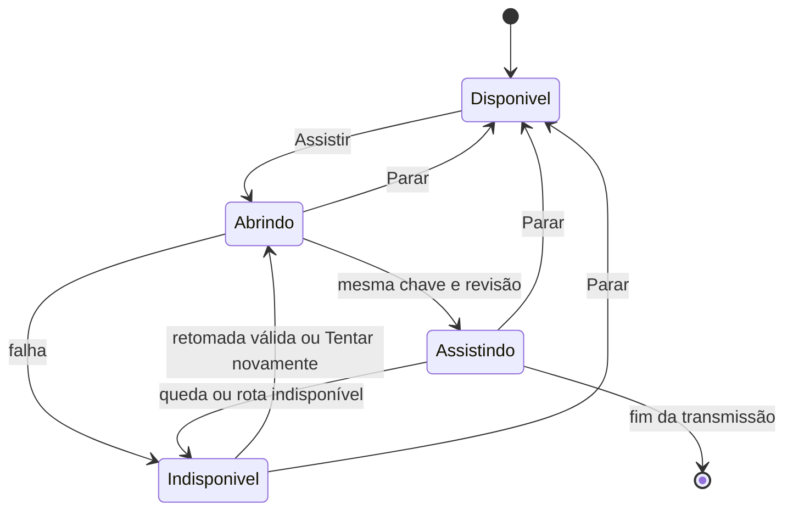

# Modelo de dados e estados

## TransmissionKey

Par `{ peerId, startedAt }` da sinalização existente, validado na fronteira. PeerId isolado não identifica uma transmissão. O servidor deve assegurar que cada novo live daquele peer tenha startedAt diferente e crescente; retomada preserva o valor. Timestamps iguais numa reinicialização devem ser normalizados pelo servidor, não confundidos com retomada.

## BroadcastOrder

Estado transitório no membro existente da sala: null antes da primeira captura ou `{ highestBroadcastSeq, requestId, lastStartedAt, status: 'live' | 'ended' }`. broadcastSeq é inteiro seguro não negativo, estritamente maior a cada nova captura da mesma identidade de membro; qualidade e reenvio preservam o valor. Primeira captura usa 0; próxima usa maior valor confirmado +1, rejeitando overflow. Não é a revision do grant de recepção. Guardar no attachment/retomada existente, conservando o maior valor e tombstone ended em hibernação e reinício enquanto a identidade de membro for válida. Descartar com essa identidade conforme a vida atual da sala.

lastStartedAt preserva o último início canônico mesmo após unlive. Nova captura recebe max(relógio atual, lastStartedAt+1), com validação de inteiro seguro. Isso conserva a unicidade/crescimento de TransmissionKey mesmo após reinício ou ajuste do relógio, sem lista de capturas antigas.

Menor seq é rejeitada. Mesma seq com requestId diferente é rejeitada. Mesma seq e mesmo requestId encerrado nunca reabre. Repetição idêntica enquanto live é idempotente e devolve a mesma chave; atualização de qualidade não cria novo início. unlive referencia seq/requestId corrente: encerra uma vez e reenvio é inócuo; stop antigo não encerra captura nova. Nova captura exige seq maior e UUID novo. Depois da retomada, o cliente usa o maior valor confirmado pelo servidor antes de alocar nova seq; sem essa confirmação não inicia outra captura.

Não há coleção de todos os UUIDs antigos: a marca de ordem com estado terminal basta para rejeitar eventos atrasados com seq antiga, inclusive depois de unlive.

## WatchChoice

Mapa positivo de peer para `{ transmission: TransmissionKey, revision, status }`. Ausência significa aguardar clique. Estados selecionados são opening, playing ou unavailable, com motivo de erro; Parar remove a entrada. Um flag separado para reprodução não autoriza envio.

- Assistir: insere escolha para transmissão vigente, incrementa revisão e publica autorização.
- Parar: remove escolha, invalida operações pendentes, envia off e limpa reprodução.
- unlive ou nova chave: remove escolha e invalida autorização de envio anterior.
- Queda temporária: conserva escolha na memória enquanto o vínculo de retomada existe; só reaplica se welcome confirmar mesma chave e identidade.
- Saída explícita, fim da sala ou perda da identidade de retomada: limpa escolhas. Nova entrada começa vazia.
- Janela escondida deriva hidden somente de escolha existente. PiP selecionado pode manter full. Sem escolha, sempre off.
- Mobile: ao escolher outra transmissão, remove a escolha anterior antes de abrir a nova.

## SendGrant

Por conexão e transmissão local: `{ transmission, revision, mode }`, com modes off, hidden, thumb ou full. Default off. Uma nova conexão invalida a sequência antiga; nova transmissão invalida todos os grants até o receptor pedir a nova chave.

Track de vídeo existe no sender somente em full/thumb; track de som somente em hidden/full/thumb. Off mantém os senders sem track, preservando transceivers e controle. A revisão precisa continuar válida antes e depois de cada mutação assíncrona. Sender não compartilha estado de autorização entre receptores.

## MediaPolicy

União de estado externo: `{ kind: 'direct-only', reason: 'unverified-budget' | 'exhausted' }`. Nesta entrega o motivo inicial é unverified-budget. Não criar variante enabled que ninguém consiga sustentar. Um futuro saldo verificado exigirá novo contrato com reservas, período de franquia e prova de interrupção; não ativar por mera existência de segredo.

Welcome e renovação informam a política e servidores STUN. Credenciais antigas são problema de transição, não saldo novo. Nenhuma entidade de pessoa ou escolha é persistida no servidor por esta feature.

## AcceptanceRun

Identificador local sem pessoa, revisão/build, versões de motor, aparelhos anonimizados, cena, qualidade efetiva, cenário 1/2 transmissores e 1/4/7 espectadores, etapas estável/perturbação/transição e medições numéricas por recepção. Estado baseline, candidate, pass, fail ou pending. Origem desconhecida de latência não é preenchida com zero; gaps ficam explícitos. Descrição das condições é fixa antes do ensaio.

Cada um dos 1.800 instantes estáveis tem categoria measured, no-video ou instrument-gap. no-video é falha de entrega com instrumento funcionando; instrument-gap é falha de medição. Cobertura instrumental inclui measured e no-video e deve atingir 1.782 instantes, sem mais de dois gaps consecutivos. Pelo menos 1.710 dos 1.800 precisam ter atraso medido ≤500 ms; nenhum gap ou no-video conta como sucesso. Falha comprovada tem precedência sobre pending por cobertura insuficiente. Guardar também cadência da origem, quadros distintos decodificados, intervalos de interrupção e FPS do jogo para aplicar SC-007, sem fabricar números ausentes.
