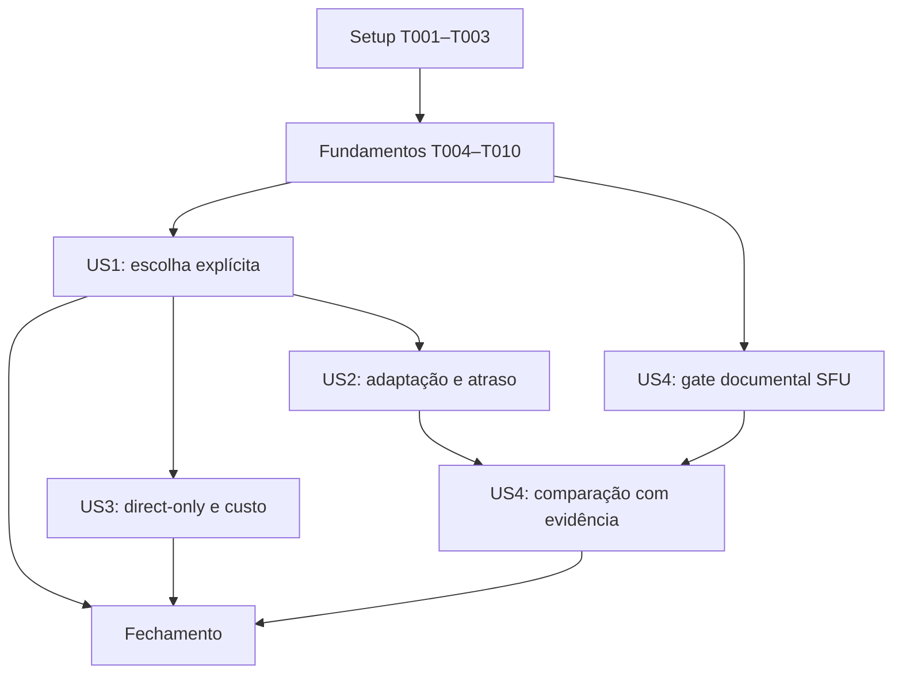

# Tasks: Transmissão sob demanda com baixo atraso e custo controlado

**Input**: documentos em `specs/017-transmissao-sob-demanda/`.
**Prerequisites**: plan.md, spec.md, research.md, data-model.md, contracts/watch.md, contracts/signaling.md, contracts/media-policy.md e quickstart.md.
**Tests**: incluir testes de comportamento e ensaios explicitamente definidos nos contratos e critérios de aceitação. Testes de regressão devem demonstrar a falha antes da correção correspondente. Mocks e testes locais não aprovam desempenho ou custo da conta.
**Organization**: setup, fundamentos comuns, uma fase por história e fechamento. Caminhos abaixo são relativos à raiz do repositório. Nenhuma tarefa está concluída.

## Format: `[ID] [P?] [Story] Description`

IDs são sequenciais. `[P]` identifica tarefas em arquivos diferentes que podem ser executadas juntas após seus pré-requisitos. `[USn]` identifica a história da especificação. Novos arquivos estão indicados no texto quando necessário.

## Phase 1: Setup (Shared Infrastructure)

**Purpose**: alinhar governança e preparar evidência reproduzível. Não atualizar dependências ou criar uma estrutura de projeto nova.

- [X] T001 Conferir a constituição 3.0.0 já emendada em .specify/memory/constitution.md, com dois passos para entrar e clique por transmissão para assistir, sem novo bump nesta tarefa. Registrar a substituição da decisão automática da 014 em DEFINICOES.md e conferir specs/017-transmissao-sob-demanda/research.md, preservando o princípio II e sem habilitar SFU.
- [X] T002 Criar specs/017-transmissao-sob-demanda/relatorio.md com revisão/build da baseline 0.1.9, inventário anonimizado de aparelhos e instrumentos, limitações e estado pending por SC-001–007; registrar npm run check, npm test e npm run build iniciais. Sem aparelhos ou instrumentos, registrar ausência sem bloquear trabalho local independente nem aprovar baseline real.
- [X] T003 Criar scripts/acceptance-017.mjs e seu teste numérico em test/scripts/acceptance-017.test.mjs, executável por node --test test/scripts/acceptance-017.test.mjs, para resumir AcceptanceRun sanitizado por recepção: p95 diagnóstico, 1.800 instantes previstos, pelo menos 1.782 com instrumento funcionando e 1.710 com atraso ≤500 ms; máximo de dois instrument-gap consecutivos. Distinguir measured/no-video/instrument-gap: no-video falha, lacuna nunca vira zero nem sai do denominador; atraso ou falta de vídeo ≥5 s reprova; cobertura insuficiente gera pending sem apagar falha comprovada. Testar limites 1.781/1.782, 1.709/1.710, duas/três lacunas, fps 26,9/27, interrupções 1%, pausa de 1 s e regressão de FPS do jogo de 5%, conforme SC-007. Preservar “Estado baseline, candidate, pass, fail ou pending”, rejeitar identidade/IP/SDP/conteúdo e valores ausentes fictícios. Guardar dados reais só em .wrangler/acceptance-017/, conferir .gitignore e documentar comando em specs/017-transmissao-sob-demanda/quickstart.md.

**Checkpoint**: emenda documentada; relatório distingue evidência local e real; ferramenta de resumo não depende de transmissão produtiva.

## Phase 2: Foundational (Blocking Prerequisites)

**Purpose**: definir a identidade canônica, a versão de sinalização e o estado visual comum antes das histórias. Não publicar estados intermediários incompatíveis.

- [X] T004 Conferir os limites de fronteira definidos em specs/017-transmissao-sob-demanda/contracts/signaling.md e contracts/watch.md antes de implementá-los em T006–T009/T018: requestId UUID v4 canônico de 36 caracteres por captura; broadcastSeq inteiro seguro não negativo, primeira 0 e próxima maior confirmada +1 sem overflow; lastStartedAt preservado e crescente; peerId conforme validação existente. Preservar “Revision é inteiro seguro não negativo e crescente no contexto da conexão” e descarte de duplicatas/grants inválidos; a revision de ctl não é broadcastSeq. Conferir 4426 em src/shared/protocol.ts, sem criar uma API alternativa.
- [X] T005 [P] Escrever testes em test/worker/media-protocol.test.ts e test/lib/signaling-media.test.ts cobrindo versão/4426, UUID e broadcastSeq inválidos, overflow, live-ack supersedido, retomada da marca e live(A) repetido após unlive(A), após live(B) e unlive(A) atrasado durante B, inclusive hibernação/reinício. Repetição ativa deve preservar ACK/chave, nova captura conservar crescimento de startedAt. Exigir somente STUN e zero geração TURN em welcome/resume/refresh v2 mesmo com segredos presentes, antes de implementar T006–T009.
- [X] T006 Definir mediaProtocol:2, MediaPolicy direct-only, requestId, broadcastSeq, live-ack, unlive identificado, broadcastOrder de retomada e fechamento 4426 em src/shared/protocol.ts, preservando endpoints; usar variantes explícitas sem estado enabled sem prova, conforme data-model.md e contracts/signaling.md.
- [X] T007 Atualizar src/worker/validate.ts para T004/T006: validar versão antes de registrar/retomar membro ou conceder ICE; preservar tamanho/frequência existentes e rejeitar UUID fora do padrão, broadcastSeq e startedAt inválidos. A revision de ctl é validada em PeerLink, sem confundi-la com a ordem de captura do servidor.
- [X] T008 Aplicar STUN_ONLY em src/worker/turn.ts antes de verificar segredos ou chamar API, e em todos os caminhos join/resume/refresh de src/worker/room.ts antes de anunciar welcome v2/direct-only. Implementar live-ack e BroadcastOrder no estado existente do membro: maior seq, UUID, lastStartedAt e live/ended; rejeitar pedidos obsoletos/encerrados sem broadcast, preservar tombstone em unlive/retomada/hibernação/reinício e descartar ao remover a identidade. Invalidar sockets/attachments legados e fazer passar T005, sem ledger ou histórico de capturas.
- [X] T009 Atualizar src/lib/signaling.ts para mediaProtocol:2, welcome/live-ack/broadcastOrder e 4426 sem fallback legado ou reconexão infinita. Expor chave canônica e maior broadcastSeq confirmado; só iniciar próxima captura após confirmar a ordem retomada, ignorando ACK de UUID/seq supersedidos. Preservar identidade válida e nunca emitir mensagem nova de captura com seq reciclada após stop.
- [X] T010 Definir em src/lib/types.ts a projeção visual available, opening, playing, stopped e unavailable; separar escolha de assistir, modo visual e status de conexão, sem usar ausência de watching como true. Definir em specs/017-transmissao-sob-demanda/contracts/watch.md como cada estado determina botões e mensagem de atualização necessária para a UI.

**Checkpoint**: STUN-only efetivo no servidor antes de qualquer anúncio v2/direct-only, contratos exercitados e identidade disponível ao emissor. Só prosseguir com as histórias após T004–T010. O protocolo novo e o cliente completo serão entregues juntos.

## Phase 3: User Story 1 - Escolher quando começar a assistir (Priority: P1)

**Goal**: nenhuma mídia alheia antes de Assistir, com autorização por transmissão e retomada segura.
**Independent Test**: duas transmissões, 60 s sem clique com zero conteúdo recebido; escolher uma em até 3 s; Parar corta imagem, som e contagem em até 2 s; reinício pede novo clique, queda da mesma transmissão preserva escolha.

### Tests for User Story 1

- [X] T011 [P] [US1] Criar test/lib/watch-state.test.ts para as transições de data-model.md: “Ausência significa aguardar clique”, estados selecionados “opening, playing ou unavailable”, Parar remove entrada, queda conserva somente mesma chave e identidade, saída limpa, reinício invalida, mobile remove escolha anterior. Verificar revisão supersedida e ausência de persistência.
- [X] T012 [P] [US1] Ampliar test/lib/peer-lifecycle.test.ts para primeiro envio sem grant, off inicial, ausência de tracks de vídeo e áudio, ctl perdido, full antigo após nova transmissão e Parar durante replaceTrack pendente. Incluir corridas live-ack/view-sync e controle que abre depois do encerramento; provar os casos que hoje enviam automaticamente.
- [X] T013 [P] [US1] Atualizar test/lib/room-view.test.ts e test/lib/view-modes.test.ts para escolha positiva: nenhuma seleção implícita por destaque, volume ou restauração, hidden mantém som só após escolha e PiP somente selecionado; contar espectadores pelo grant/fluxo válido, sem contar cartões ou recepção só de som.

### Implementation for User Story 1

- [X] T014 [US1] Criar cenas watch-available, watch-stopped, watch-opening, watch-playing, watch-unavailable e watch-reconnecting em src/mocks/room.ts e registro em src/mocks/registry.ts se necessário; mostrar duas transmissões e todos os estados sem rede ou captura, usando os tipos T010.
- [X] T015 [US1] Adaptar src/ui/components/StreamTile.svelte aos mocks T014 antes da lógica real: cartão inicial com Assistir e identificação textual, stopped com texto próprio, opening e unavailable sem player oculto nem miniatura ao vivo. Preservar tokens, teclado e isolamento do clique do botão em relação ao destaque.
- [X] T016 [US1] Criar src/lib/watch-state.ts como reducer de escolhas positivas por `{peerId,startedAt}` e revisão em memória; aplicar “Nova entrada começa vazia” e “Sem escolha, sempre off”, removendo escolha em Parar, unlive, nova chave e perda de identidade. Não criar flag global de assistir ou persistência local de consentimento.
- [X] T017 [US1] Migrar src/lib/room-view.ts de unwatched para escolhas positivas T016 e derivar full/thumb/hidden/off sem ativação implícita; no celular remover a escolha anterior antes da nova. Fazer passar T013 e eliminar a API negativa antiga após migrar os chamadores.
- [X] T018 [US1] Implementar grant de ctl v2 em src/lib/peer.ts: validar a chave local e revisão conforme T004; default off; “Track de vídeo existe no sender somente em full/thumb; track de som somente em hidden/full/thumb”. Manter senders sem track antes de consentir, invalidar grants em nova conexão/transmissão e perda do ctl, verificar revisão antes/depois de awaits e processar view-sync sem criar escolha automática.
- [X] T019 [US1] Atualizar src/lib/mesh.ts para fornecer a chave canônica atual a cada PeerLink, remover fallback hidden/full e reaplicar somente grants válidos; propagar unlive e nova transmissão antes de setLocal, preservando um controle negociável sem tracks. Garantir isolamento entre receptores e integrar contagem baseada em vídeo efetivamente enviado.
- [X] T020 [US1] Integrar src/lib/watch-state.ts em src/lib/stores/room.svelte.ts: substituir unwatched, gerar UUID e broadcastSeq novo por captura, enviar unlive identificado, aguardar live-ack compatível, solicitar view-sync e conservar escolha apenas na mesma transmissão retomada. Qualidade conserva UUID/seq; captura nova aguarda broadcastOrder confirmado na retomada. Iniciar transmissão própria não altera escolhas alheias; remover caminhos legados após migrá-los.
- [X] T021 [US1] Ligar Assistir, Parar e Tentar novamente à escolha explícita em src/lib/stores/room.svelte.ts e src/ui/pages/RoomPage.svelte, src/ui/pages/MobileRoomPage.svelte ou src/routes/RoomRoute.svelte conforme os eventos existentes; o toast Assistir deve escolher antes de destacar. Timers de primeiro quadro só existem para escolhas ativas; restaurar janela, volume e foco não geram consentimento.
- [X] T022 [US1] Completar a integração de cancelamento e reprodução em src/lib/stores/room.svelte.ts e src/ui/components/StreamTile.svelte: limpar players e escolha supersedida, impedir ontrack/resultado tardio de reativar recepção e preservar volume/mudo. Conferir preview próprio, PiP, câmera, tela e atualização da contagem em até 2 s sem reiniciar toda a sala.
- [X] T023 [US1] Criar fixtures de cliente legado em test/lib/signaling-media.test.ts e test/worker/media-protocol.test.ts para matriz novo/novo, antigo/novo, novo/antigo e attachment anterior em retomada; comprovar atualização explícita sem conteúdo automático nem emissão antecipada de credenciais. Executar os testes T011–T013 junto dessas fixtures e registrar resultados em specs/017-transmissao-sob-demanda/relatorio.md.
- [X] T024 [US1] Executar npm run check, npm test e npm run build, abrir as seis cenas T014 em viewport desktop e mobile e registrar evidência visual em specs/017-transmissao-sob-demanda/relatorio.md. Corrigir falhas da história nos arquivos correspondentes; mocks não aprovam envio real.
- [ ] T025 [US1] Executar o roteiro real de ausência de mídia/lifecycle de specs/017-transmissao-sob-demanda/quickstart.md com duas transmissões e registrar SC-001/002/006 em specs/017-transmissao-sob-demanda/relatorio.md: 60 s sem clique, deltas RTP/decodificação, início ≤3 s, corte ≤2 s, reinício, queda, ctl e cliques rápidos. Se faltarem sessões reais, manter tarefa e critérios pendentes com motivo verificável.

**Checkpoint**: MVP local de US1 demonstrável, sem aceitar ausência de player como prova de ausência de mídia. A entrega produtiva depende também do controle de custo de US3 e da transição de protocolo.

## Phase 4: User Story 2 - Assistir junto sem acumular atraso (Priority: P1)

**Goal**: adaptar a imagem preservando o momento atual, com isolamento de rede por receptor e metas medidas.
**Independent Test**: matriz 1/2 transmissões × 1/4/7 espectadores em sessões de 30 min; p95 por recepção ≤500 ms, nenhuma amostra ≥5 s; cinco repetições por perturbação/transição, recuperação ≤5 s e A/V ≤200 ms.

### Tests for User Story 2

- [X] T026 [P] [US2] Ampliar test/lib/quality.test.ts e test/lib/peer-codecs.test.ts para perfis detail/text/motion, fallback câmera-movimento/tela-detalhe, máximo escolhido, contagem só de espectadores ativos e qualidade efetiva; preferência de codec não deve ser tratada como prova de encoder de hardware.
- [X] T027 [P] [US2] Ampliar test/lib/cpu-governor.test.ts e test/lib/media-stats.test.ts para pressão local versus bandwidth de um receptor, falta/reset de amostras e dados de encoder indisponíveis; preservar inicialmente limiares 10 s/60 s e não transformar indicador parcial em atraso ponta a ponta.

### Implementation for User Story 2

- [ ] T028 [US2] Fixar aparelhos, GPU, cenas, capacidade de rede, etapas estáveis e instrumentos no relatório specs/017-transmissao-sob-demanda/relatorio.md e obter baseline real 0.1.9 com scripts/latency-source.html e scripts/acceptance-017.mjs antes de ajustar qualidade. Sem aparelhos, registrar pending e continuar somente verificações locais independentes, sem inventar limiares a partir de baseline ausente.
- [X] T029 [US2] Implementar perfis por contentHint/origem em src/lib/quality.ts e src/lib/capture.ts, src/lib/camera.ts e src/lib/native-capture.ts conforme a origem do track: detail/text preserva detalhe, motion preserva movimento, câmera sem hint usa movimento e tela sem hint usa detalhe. Preservar tetos existentes e qualidade escolhida; não adicionar classificador de pixels nem alterar captura Rust.
- [X] T030 [US2] Aplicar o perfil ao degradationPreference e aos encodings por receptor em src/lib/peer.ts, mantendo serialização e validação de revisão T018. Rede ruim de um receptor não deve reduzir captura global; ausência de suporte do motor usa o fallback definido e fica visível no diagnóstico.
- [X] T031 [US2] Revisar src/lib/stores/room.svelte.ts e src/lib/cpu-governor.ts para somente pressão de codificação local confirmada poder reduzir qualidade global, exibindo qualidade efetiva. Preservar 10 s/60 s salvo evidência T028 registrada que justifique ajuste; não criar configuração manual de atraso para usuários.
- [X] T032 [US2] Completar os diagnósticos locais de src/lib/media-stats.ts e src/lib/stores/room.svelte.ts com o perfil e implementação efetiva do encoder, quando disponíveis, preservando retenção limitada e exportação sanitizada para scripts/acceptance-017.mjs. Não incluir IPs, SDP ou identificadores permanentes nem chamar RTT de atraso visual.
- [ ] T033 [US2] Executar a matriz estável do quickstart.md e registrar em specs/017-transmissao-sob-demanda/relatorio.md cada recepção: 1.800 instantes, ≥1.782 instrumentados, ≤2 gaps consecutivos, ≥1.710 atrasos ≤500 ms, sem atraso/falta de imagem ≥5 s. Aplicar distinção no-video/instrument-gap e precedência de falha; texto ≥19/20 com parâmetros fixos e movimento ≥27 fps com fonte ≥30, interrupções ≤1%, sem pausa >1 s. Marcar SC-003/007 pass/fail/pending com dados de CPU/GPU/jogo e referências pré-fixadas.
- [ ] T034 [US2] Executar cinco repetições de cada perturbação/transição do quickstart.md, incluindo isolamento de espectador lento, e registrar atraso, tempo de recuperação, A/V com instrumento ≤20 ms e encerramento durante recuperação em specs/017-transmissao-sob-demanda/relatorio.md. Aprovar SC-004 somente com evidência real; não substituir dados ausentes por zero ou excluir intervalos ruins depois do ensaio.

**Checkpoint**: política de adaptação testada localmente; eficácia só concluída após T028/T033/T034. Falta de aparelhos mantém a aceitação aberta.

## Phase 5: User Story 3 - Usar sem exceder o saldo gratuito (Priority: P1)

**Goal**: executar o ramo seguro previsto em FR-017, somente STUN, e explicar indisponibilidade de redes que dependem de relay.
**Independent Test**: welcome/resume/refresh não emitem TURN mesmo com segredos configurados; saldo não comprovado nunca habilita relay; rota direta funciona e rede restritiva recebe explicação. Proteção global da conta exige drenagem comprovada separadamente.

### Tests for User Story 3

- [X] T035 [P] [US3] Criar test/worker/media-policy.test.ts cobrindo mintIceServers com chaves presentes e ausentes, entradas concorrentes, resume, refresh, falha/reinício e credenciais legadas; interceptar requisições de geração e exigir zero chamadas externas para obter TURN em todos os caminhos direct-only, sem expor segredos nos resultados.
- [X] T036 [P] [US3] Criar test/lib/media-policy.test.ts para welcome/refresh com ICE legado, política sem prova, rota relay incompatível, reconstrução STUN-only e falha persistente: nenhuma tentativa ilimitada, nenhuma recepção não escolhida e indisponibilidade sem derrubar outros peers diretos.

### Implementation for User Story 3

- [X] T037 [US3] Auditar a política STUN_ONLY já aplicada em T008 em src/worker/turn.ts e src/worker/room.ts usando T035: segredos presentes/ausentes, concorrência, refresh, resume e reinício não habilitam emissão. Conferir `{ kind: 'direct-only', reason: 'unverified-budget' }` e enum reason `'unverified-budget' | 'exhausted'`; registrar em specs/017-transmissao-sob-demanda/relatorio.md sem adicionar ledger, enabled ou nova flag de ativação.
- [X] T038 [US3] Aplicar a política em src/lib/signaling.ts, src/lib/mesh.ts e src/lib/peer.ts: filtrar ICE recebido para STUN/STUNS, descartar configuração antiga em nova conexão e reconstruir conexão que reporte relay proibido preservando apenas escolhas válidas. Permitir no máximo uma reconstrução automática por falha antes de indisponibilidade; Tentar novamente manual inicia nova tentativa, sem prometer conectividade em toda rede.
- [X] T039 [US3] Projetar indisponibilidade de retransmissão em src/lib/stores/room.svelte.ts e src/ui/components/StreamTile.svelte, incluindo erro de atualização e Tentar novamente apenas para escolha existente; usar motivo claro sem saldo numérico fictício, preservar demais peers e estender o mock watch-unavailable em src/mocks/room.ts.
- [X] T040 [US3] Executar T035/T036 e integração Worker/cliente com versões e credenciais antigas, além de npm run check, npm test e npm run build; registrar em specs/017-transmissao-sob-demanda/relatorio.md o resultado de SC-005 no ramo disabled e o ramo de saldo positivo explicitamente não exercitado.
- [X] T041 [US3] Escrever specs/017-transmissao-sob-demanda/release-checklist.md com procedimento de transição: cliente/Worker v2 juntos, drenagem de sockets antigos, interrupção de emissão, inventário de emissores/uso compartilhado, último issuedAt+TTL máximo e conferência do saldo durante a drenagem. Credenciais atuais têm seis horas; revogação não prova corte imediato. Documentar rollback que não reative emissão TURN ou mídia automática; não executar deploy, revogação ou mudanças de conta nesta tarefa.
- [ ] T042 [US3] Validar numa rede de teste a conexão direta e a indisponibilidade quando a rede exige relay, sem consumir tráfego TURN real; registrar em specs/017-transmissao-sob-demanda/relatorio.md a mensagem, tentativa manual e isolamento dos outros pares. Manter proteção financeira global da conta pendente até execução autorizada e evidenciada do procedimento em release-checklist.md.

**Checkpoint**: implementação direct-only pode ser aprovada sem ledger fictício. Saldo positivo, consumo residual da conta e eventual SFU não são aprovados por esses testes.

## Phase 6: User Story 4 - Comparar antes de mudar a distribuição (Priority: P2)

**Goal**: produzir comparação auditável do caminho atual e das melhorias locais, com decisão explícita sobre avaliação SFU, sem provisionar mídia paga.
**Independent Test**: processar duas execuções com o mesmo cenário e qualidade e obter relatório por recepção; divergência de condições ou ausência de dados produz pending, nunca ganho presumido.

- [X] T043 [P] [US4] Consolidar em specs/017-transmissao-sob-demanda/sfu-assessment.md os requisitos para futura prova SFU: emenda II, decisão de criptografia, autoridade para interromper consumo e orçamento agregado. Reusar research.md e contratos oficiais já citados, marcando atendido/não atendido com evidência; nenhuma integração, segredo ou provisionamento nesta tarefa.
- [X] T044 [US4] Comparar baseline T028 e candidato T033/T034 com scripts/acceptance-017.mjs e registrar em specs/017-transmissao-sob-demanda/relatorio.md as condições equivalentes, resultados por recepção, consumo direto e limites da inferência. Se faltar uma rodada, produzir estrutura e motivo de pending, sem preencher melhora fictícia.
- [ ] T045 [US4] Completar SC-007 em specs/017-transmissao-sob-demanda/relatorio.md com baseline/candidato equivalentes: texto ≥19/20 com fonte/tamanho fixos, cena mista, movimento ≥27 fps, interrupções ≤1%, sem pausa >1 s, e mediana de FPS do jogo ≥95% da baseline com mesmos aparelhos/cena/configurações/limite. Medir com DevTools desconectado; falta de tarefa equivalente mantém esse aceite pending, sem diminuir referências após o resultado. Registrar CPU/GPU, memória e regressões.
- [X] T046 [US4] Registrar em specs/017-transmissao-sob-demanda/sfu-assessment.md o resultado do gate SFU e a decisão de manter distribuição padrão; enquanto houver gate não atendido, marcar comparação remota pending e indicar a dependência concreta, sem marcar implementação ou ensaio SFU como concluídos.
- [X] T047 [US4] Atualizar docs/adr/0001-conexao-direta-e-franquia-de-midia.md e specs/017-transmissao-sob-demanda/relatorio.md com decisão resultante e limites: 500 ms só se medido, ramo de saldo positivo não exercitado e nenhuma migração Rust aprovada. Revisar os artefatos numéricos de .wrangler/acceptance-017/ e exportar somente resumos sanitizados necessários à revisão.

**Checkpoint**: comparação local e motivos de pendência auditáveis; nenhum cenário fictício é apresentado como teste real da SFU.

## Phase 7: Polish & Cross-Cutting Concerns

**Purpose**: concluir integração, rastreabilidade e documentação sem confundir checks locais com aceite externo.

- [ ] T048 Revisar acessibilidade, keyboard, desktop/mobile e os seis mocks nos arquivos src/ui/components/StreamTile.svelte, src/ui/pages/RoomPage.svelte e src/ui/pages/MobileRoomPage.svelte, conferindo também câmera, tela, som, PiP e ausência de preview automático; registrar a matriz de regressão em specs/017-transmissao-sob-demanda/relatorio.md.
- [ ] T049 Executar os checks finais npm run check, npm test e npm run build e o roteiro integrado de specs/017-transmissao-sob-demanda/quickstart.md; executar cargo test/build desktop somente se Rust/configuração nativa tiverem sido alterados. Registrar comandos, revisões e resultados em specs/017-transmissao-sob-demanda/relatorio.md e corrigir apenas falhas comprovadas.
- [X] T050 Conferir e registrar em specs/017-transmissao-sob-demanda/relatorio.md a cobertura final de FR-001–020 e SC-001–007, separando pass/fail/pending por teste local, ensaio real e conta externa; nenhuma pendência de medições ou drenagem deve virar check concluído por falta de aparelhos ou de tempo.
- [X] T051 Atualizar README.md, DEFINICOES.md e specs/017-transmissao-sob-demanda/quickstart.md para Assistir por clique, limitação de rede direct-only e comandos/cenas realmente disponíveis, com aviso de que pesquisa SFU não é distribuição ativa. Preservar documentos históricos 014/016 e referenciar sua substituição somente no comportamento alterado.
- [X] T052 Verificar git diff --check, a coerência da constituição após T001, os contratos e specs/017-transmissao-sob-demanda/release-checklist.md; registrar em specs/017-transmissao-sob-demanda/relatorio.md o resultado e as pendências para uma futura publicação. Não publicar site/app, revogar credenciais nem declarar drenagem da conta realizada por esta tarefa.

## Dependencies & Execution Order

### Phase dependencies

- Setup T001–T003 precede fundamentos T004–T010. T001 confere a emenda 3.0.0 já realizada, sem deixar mudança de governança pendente para a implementação.
- Fundamentos: T004 → T005/T006 → T007 → T008 → T009 → T010. T005 estabelece comportamento esperado; T008 desabilita emissão TURN antes de welcome v2. T006–T009 devem passar como unidade, sem publicar estágios intermediários ou aguardar T037 para aplicar direct-only.
- US1: testes T011/T012/T013 podem rodar juntos. T010 → T014 → T015 entrega visual mockado antes da lógica. T011 → T016 → T017; T012 → T018 → T019; T009/T016/T017/T019 → T020 → T021 → T022 → T023 → T024 → T025.
- US2: começa sobre a integração de US1 T024. T026/T027 podem rodar juntos; T028 precede alterações de política dependentes de baseline. T026/T028 → T029 → T030; T027/T028 → T031; T030/T031 → T032 → T033 → T034. Sem baseline real, somente preparação e testes independentes avançam; aceitação permanece pendente.
- US3: testes T035/T036 podem ser preparados após fundamentos. T008/T035 → T037 audita a política já efetiva; T036/T037 e integração de US1 → T038 → T039 → T040 → T041 → T042. Não editar peer/store em paralelo com US1 ou US2; integrar alterações serialmente. Pode-se preparar testes/documentação em arquivos distintos enquanto US2 aguarda aparelhos.
- US4: T043 é documental e pode avançar após fundamentos. T028/T033/T034 → T044 → T045; T043 → T046; T044/T045/T046 → T047. Com evidência ausente, o relatório pode ser preparado, mas ensaios dependentes permanecem pending.
- Fechamento T048–T052 sucede a integração local das histórias. T050 exige evidência dos aceites, e deve preservar pendências em vez de encerrá-las artificialmente.

Setas indicam dependências lógicas. US2 e US3 compartilham arquivos de integração e não devem ser editadas simultaneamente. Validação de conta produtiva e SFU remota não são dependências para desenvolver o MVP local, mas continuam limites explícitos de aceite/publicação.

### Parallel opportunities and examples per story

- US1, após fundamentos: T011 em test/lib/watch-state.test.ts, T012 em test/lib/peer-lifecycle.test.ts e T013 em test/lib/room-view.test.ts/test/lib/view-modes.test.ts. Os mocks T014 podem ser preparados separadamente após os tipos, sem tocar testes ou peer.
- US2, após US1 local: T026 em test/lib/quality.test.ts/test/lib/peer-codecs.test.ts e T027 em test/lib/cpu-governor.test.ts/test/lib/media-stats.test.ts. A coleta T028 depende de aparelhos e não autoriza ajustes sem seus resultados.
- US3, após fundamentos: T035 em test/worker/media-policy.test.ts e T036 em test/lib/media-policy.test.ts. T041 só é finalizado após a política executável, mas não executa operações de conta.
- US4: T043 em sfu-assessment.md pode ser redigido enquanto ensaios US2 geram dados. T044/T045 compartilham relatorio.md e são sequenciais. T046 pode ser preparado em sfu-assessment.md enquanto a comparação aguarda, desde que T043 esteja pronto.

Os exemplos são oportunidades de execução, não instrução para criar agentes ou chats. Tarefas sem `[P]` mantêm a sequência declarada por compartilharem arquivos, evidência ou estado.

## Implementation Strategy

### MVP first

Concluir setup, fundamentos e US1, incluindo visual mockado, autorização antes de qualquer track e prova real de ausência de imagem e som. Esse é o MVP local. Para publicação futura, incluir US3 e satisfazer transição de clientes/credenciais; uma demonstração local não autoriza desligar TURN ou atualizar salas produtivas.

### Incremental delivery

Preservar contratos e código de captura existentes enquanto migra os chamadores. Remover APIs legadas na mesma unidade que os migra, sem camada temporária que permita envio automático. Completar US2 somente com evidência de atraso/qualidade; completar o ramo seguro de US3 declarando o saldo positivo não exercitado. US4 consolida decisão e pendências, mantendo SFU documental sem criar servidor inutilizado.

### Traceability and acceptance

| Requisitos/critérios | Tarefas principais |
| --- | --- |
| FR-001–007, FR-011, FR-020; SC-001/002/006 | T004–T025, T048 |
| FR-008–012; SC-003/004 | T026–T034 |
| FR-013–017; SC-005 | T005/T008, T035–T042, T052 |
| FR-018/019; SC-007 | T002/T003/T028/T032–T034/T043–T047 |

Todos os FR têm história e verificação mapeadas. FR-014–017 usam nesta entrega a alternativa de retransmissão desabilitada prevista em FR-017. O caminho de saldo positivo e a comparação remota SFU permanecem condições não demonstradas, sem tarefas que os habilitem implicitamente.

## Notes

Testes, build e especificação não aprovam performance real nem cobrança. Relatórios sem dados precisam dizer pending. Não editar checklists de revisão para contornar gates de implementação. Não criar novas tabelas de pessoas, ledger global, dependências de UI, atualização de bibliotecas, migração Rust ou publicação neste fluxo.

## Estado da execução em 2026-11-05

44 tarefas locais concluídas e 8 pendentes. As pendentes são T025/T028/T033/T034/T042/T045 e as partes reais da matriz T048/T049. O ensaio PeerLink local usa duas fontes sintéticas e comprovou 60 s sem mídia antes da escolha, mas não comprova toda a sala, nove aparelhos, PiP/captura reais, rede restritiva ou a meta de 500 ms.

Testes de custo e lifecycle foram consolidados nos arquivos novos media-protocol.test.ts, media-policy.test.ts, signaling-media.test.ts e nos testes existentes de Room/PeerLink. T026/T027 incluem revisão da cobertura existente e teste novo de perfil de conteúdo; nenhum limiar de governor foi alterado. T044/T046/T047 concluem documentação de resultados pendentes, sem marcar o ensaio remoto como executado. T050 mantém o mapeamento de aceites com seus estados parciais/pending.

Conforme ajuste de sequência registrado no plan.md, o código de hints foi desenvolvido e validado localmente sem alterar tetos ou governor, preservando a baseline antiga para ensaio posterior. Nenhuma comparação real foi inventada para liberar T028. A checklist de requisitos foi tratada como gate somente leitura durante implement.
